# 实践项目2：个人实验报告

> 本报告记录「通过 GitHub Actions 自动部署静态文档到 GitHub Pages」的完整实践过程。
> 文中截图均为本人在本机实际操作时截取，涉及的操作、命令输出与运行记录都可在仓库提交历史与 Actions 页面复核。

## 1. 基本信息

- 姓名：占竞
- 学号：202430224058
- GitHub 登录名：Jing-Zhan
- 个人仓库地址：<https://github.com/Jing-Zhan/my-docs>
- 最终网站地址：<https://jing-zhan.github.io/my-docs/>

## 2. 实践过程与关键截图

### 2.1 仓库创建

**做了什么**：登录 GitHub 后新建仓库 `my-docs`，Owner 选本人账号 `Jing-Zhan`，可见性选 **Public**，默认分支确认为 `main`。仓库不勾选初始化 README，让首次提交由本地推送完成，这样提交历史从第一条起就是真实内容。

**为什么**：作业要求公开仓库且默认分支为 `main`，工作流里的 `on.push.branches: [main]` 与 `path` 过滤都依赖这个分支名；仓库为空也便于一次推送就带上完整目录结构。

**结果**：仓库主页显示所有者 `Jing-Zhan`、仓库名 `my-docs`，右侧有 `Public` 标识；文件列表中可以看到 `.github/workflows`、`docs`、`report`、`mkdocs.yml`、`requirements.txt` 等本次作业要求的全部内容。

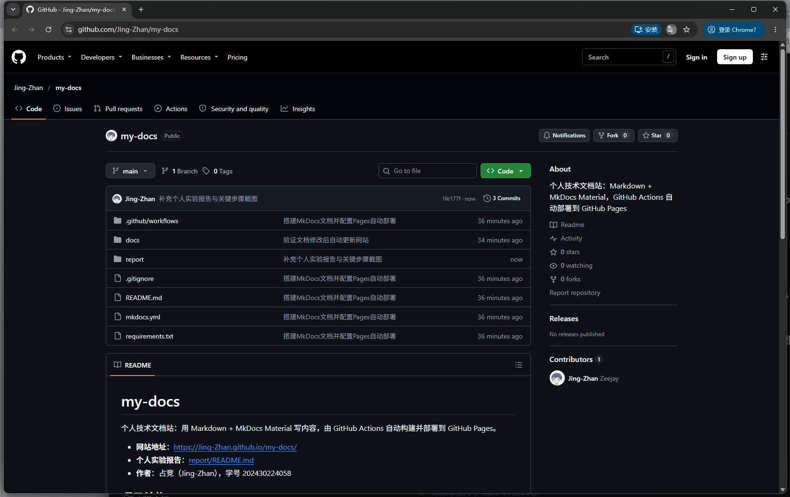

### 2.2 项目结构与 MkDocs 配置

**做了什么**：在本地按作业要求创建目录与文件：`docs/`（四页 Markdown）、`mkdocs.yml`、`requirements.txt`、`.gitignore`、`.github/workflows/deploy.yml` 和 `report/`（报告与截图）。用资源管理器确认目录结构，用记事本打开 `mkdocs.yml` 核对配置。

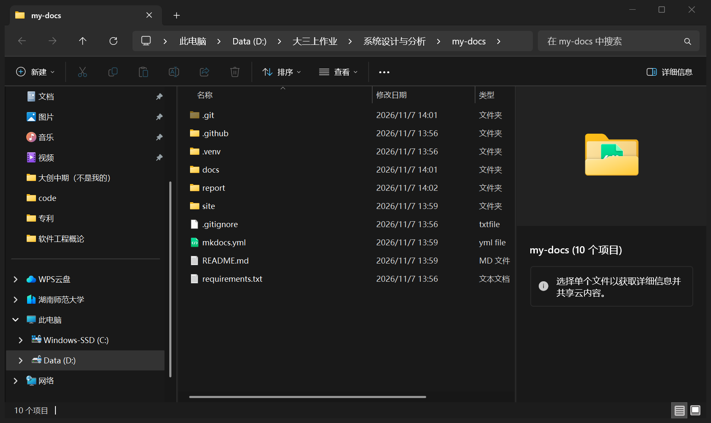

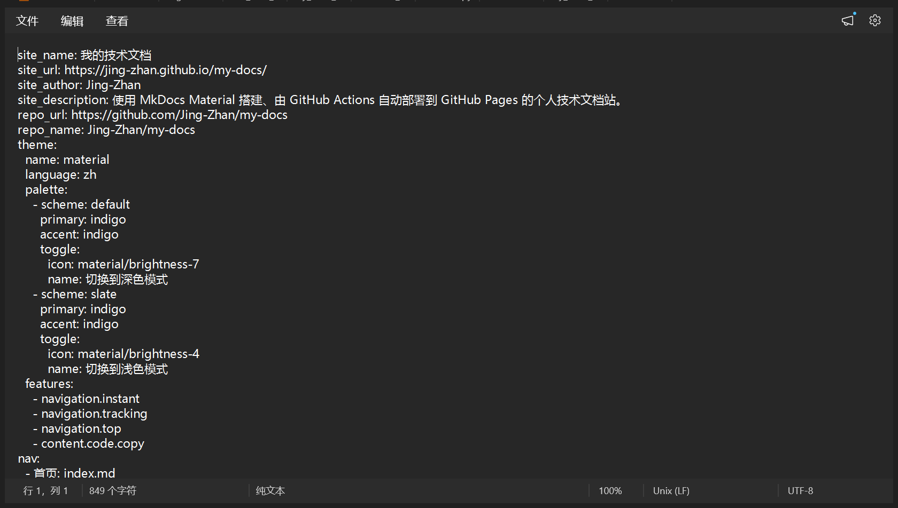

**结果与三个关键概念**：

| 对象 | 作用 | 是否需要提交 |
| --- | --- | --- |
| `docs/` | 网站内容源文件，`nav` 里写的路径都相对于它（如 `index.md`，不能写 `docs/index.md`） | 需要 |
| `mkdocs.yml` 的 `nav` | 决定左侧导航的条目、顺序和对应页面，是"目录 → 页面"的映射表 | 需要 |
| `site/` | `mkdocs build` 生成的静态网站（HTML/CSS/JS），本项目里还含 `search/`、`sitemap.xml` | 不需要，已写入 `.gitignore` |

`site/` 不提交的原因很直接：它是 `docs/` 的产物，每次构建都可重新生成；如果提交，仓库会出现"产物比源码还旧"和每次构建都产生大 diff 的问题。`.venv/` 同理，属于本机环境，不进仓库。

### 2.3 本地构建与预览

**做了什么**：用 Python 3.11 建虚拟环境，安装 `requirements.txt` 里的依赖（实际装到 `mkdocs 1.6.1`、`mkdocs-material 9.8.0`），执行严格构建，再启动本地预览逐页检查。

```text
PS D:\大三上作业\系统设计与分析\my-docs> .\.venv\Scripts\Activate.ps1
(.venv) PS D:\大三上作业\系统设计与分析\my-docs> python -m mkdocs build --strict
INFO    -  Cleaning site directory
INFO    -  Building documentation to directory: D:\大三上作业\系统设计与分析\my-docs\site
INFO    -  Documentation built in 0.39 seconds
(.venv) PS D:\大三上作业\系统设计与分析\my-docs> python -m mkdocs --version
python -m mkdocs, version 1.6.1 from D:\大三上作业\系统设计与分析\my-docs\.venv\Lib\site-packages\mkdocs (Python 3.11)
```

`--strict` 的作用是把警告升级为失败：链接写错、`nav` 指向不存在的文件、缺少页面都会让构建返回非 0，从而在本地就暴露问题，而不是等线上出现 404。

**本地预览**：`python -m mkdocs serve` 启动后监听 `http://127.0.0.1:8000/my-docs/`（因为 `site_url` 带仓库子路径，预览地址也带 `/my-docs/`）。

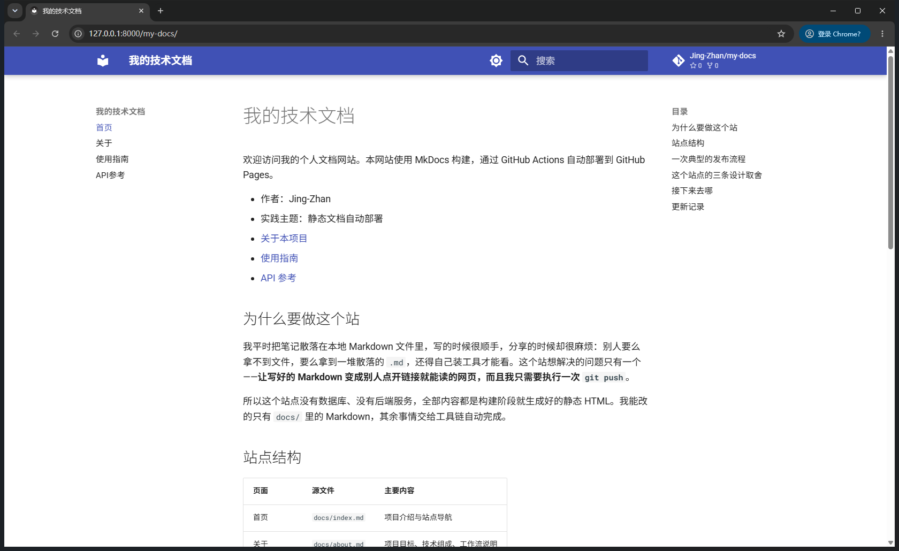

**检查了哪些内容**：

- 左侧导航四项（首页、关于、使用指南、API 参考）均可点击跳转，当前页高亮正确；
- 首页"站点结构"表格、代码块正常渲染，代码块右上角有复制按钮；
- 关于页表格、使用指南页的命令代码块、API 参考页的 JSON 代码块与参数表格均正常；
- 页面间链接（`about.md` / `guide.md` / `api.md` 之间的相对链接）均可跳转；
- 深色/浅色主题切换按钮可用。

### 2.4 Pages 设置

**做了什么**：进入 `Settings` → `Pages` → `Build and deployment`，把 `Source` 设为 **GitHub Actions**（不是 `Deploy from a branch`）。

**为什么**：本文采用官方 Pages Actions 方案，产物由 `upload-pages-artifact` + `deploy-pages` 发布，不需要 `gh-pages` 分支，也不需要额外的访问令牌；如果保留分支发布，工作流里的部署步骤不会生效。

**结果**：页面显示 "Your site is live at https://jing-zhan.github.io/my-docs/"，并提示 "Your site was last deployed to the github-pages environment by the Deploy MkDocs to GitHub Pages workflow"。

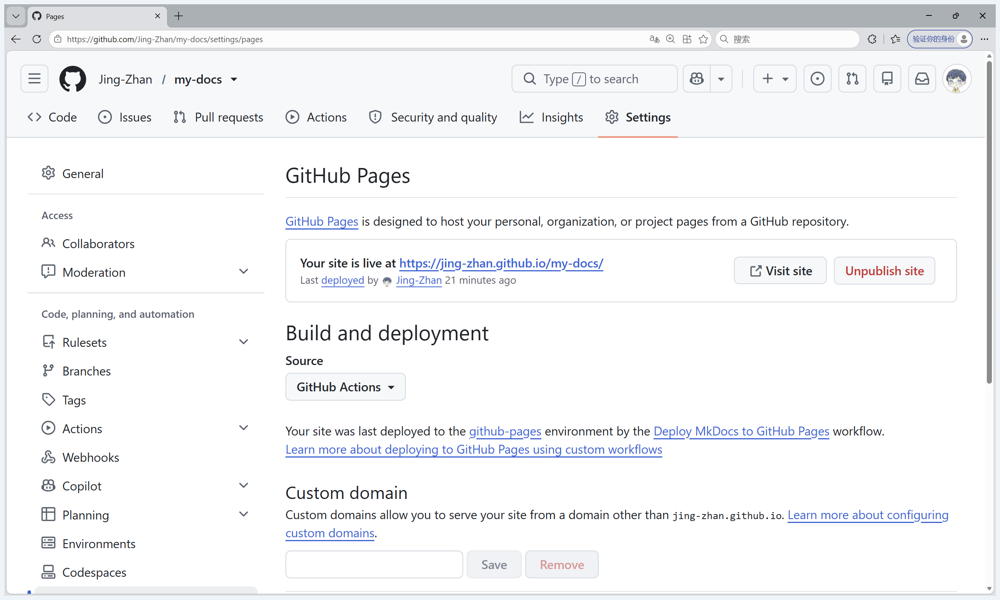

### 2.5 Actions 首次构建和部署

**做了什么**：提交并推送首条提交 `65779f3 搭建MkDocs文档并配置Pages自动部署`，随后打开 `Actions` 页面观察运行。

**结果**：`Deploy MkDocs to GitHub Pages` 运行结束，状态 **Success**，总耗时 34s；`build` 任务 16s、`deploy` 任务 10s 均为绿色通过，触发方式为 push，提交号 65779f3。

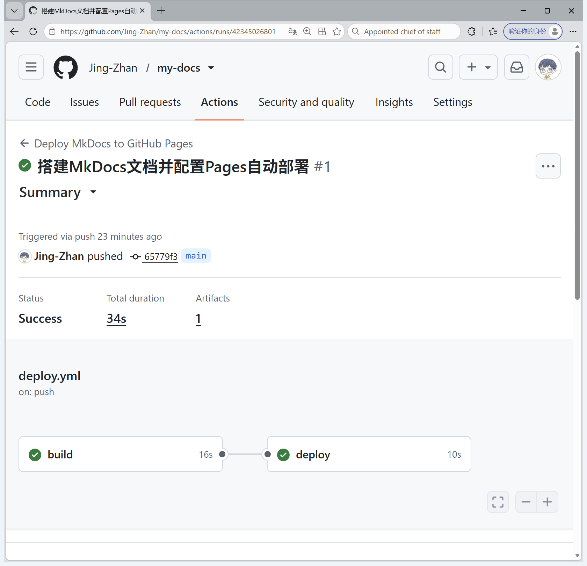

**工作流各配置项的理解**（用自己的话解释）：

- `on.push.branches: [main]` + `paths`：只有改动 `docs/**`、`mkdocs.yml`、`requirements.txt` 或工作流自身，并推送到 `main` 时才运行。改报告或 README 不会触发，避免无意义的构建。
- `workflow_dispatch`：允许在 Actions 页面手动点 "Run workflow"，首次排错或补部署时很有用。
- `build` 任务：依次做检出源码、装 Python 3.12、`configure-pages`、装依赖、`mkdocs build --strict`、上传 `site/` 作为 Pages 产物。它不接触线上环境，失败也只影响这次运行。
- `deploy` 任务：`needs: build` 保证只有构建成功才部署；任务级权限单独声明 `pages: write` 与 `id-token: write`，其余仍是只读。
- `environment: github-pages`：把部署记录挂到 `github-pages` 环境上，Pages 页面显示的"由哪个工作流最后部署"就来自这里。
- `concurrency.group: pages`：同一时刻只允许一个 Pages 部署，避免两次推送互相覆盖。

### 2.6 网站访问与四页导航检查

**做了什么**：部署完成后在浏览器打开 <https://jing-zhan.github.io/my-docs/>，逐一访问四个页面。

**四页导航检查结果**：首页、关于、使用指南、API 参考均返回 200，左侧导航四项互跳正常，无 404、无样式丢失。

| 页面 | 地址 | 检查内容 |
| --- | --- | --- |
| 首页 | `/my-docs/` | 表格、代码块、页面内链接 |
| 关于 | `/my-docs/about/` | 技术组成表格、流程图说明 |
| 使用指南 | `/my-docs/guide/` | 命令代码块、目录约定表、排错表 |
| API 参考 | `/my-docs/api/` | 参数表格、JSON 示例、错误码表 |

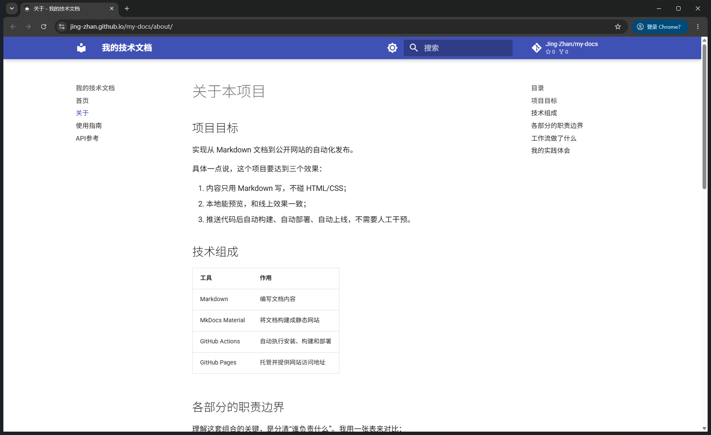

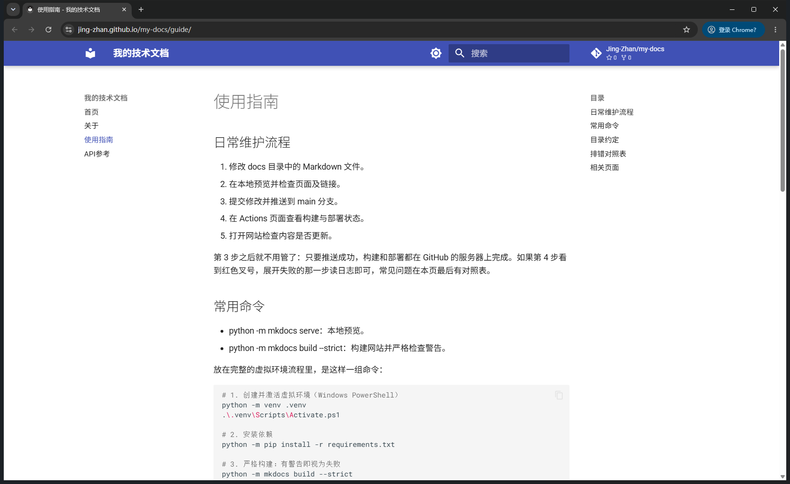

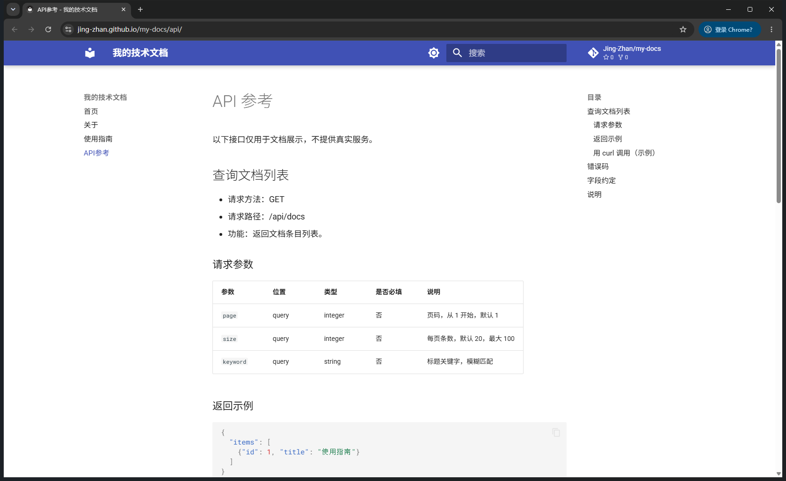

### 2.7 第二次推送与自动更新验证

**做了什么**：在 `docs/index.md` 末尾新增一节"更新记录"，写入一句容易辨认的话：

```markdown
## 更新记录

- 自动部署验证：这是我第二次推送后更新的内容。
```

然后提交并推送（**没有**在 Actions 页面手动触发）：

```bash
git add docs/index.md
git commit -m "验证文档修改后自动更新网站"
git push origin main
```

**结果**：推送后自动出现新的运行记录 `#2 验证文档修改后自动更新网站`，状态 **Success**，总耗时 31s（`build` 14s、`deploy` 9s），部署步骤里直接给出站点地址。刷新公开网站后，首页出现"更新记录"一节和新增的那句话。

- 对应提交链接：<https://github.com/Jing-Zhan/my-docs/commit/cfb62414fc6707a9c0be92c4e05e4eca9026695b>
- 对应 Actions 运行链接：<https://github.com/Jing-Zhan/my-docs/actions/runs/42345176608>

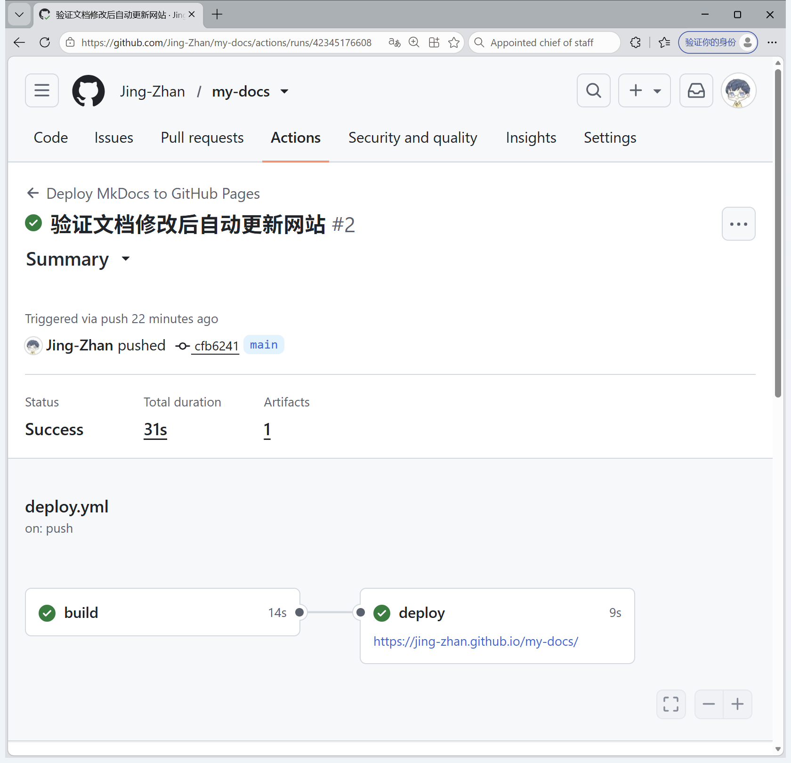

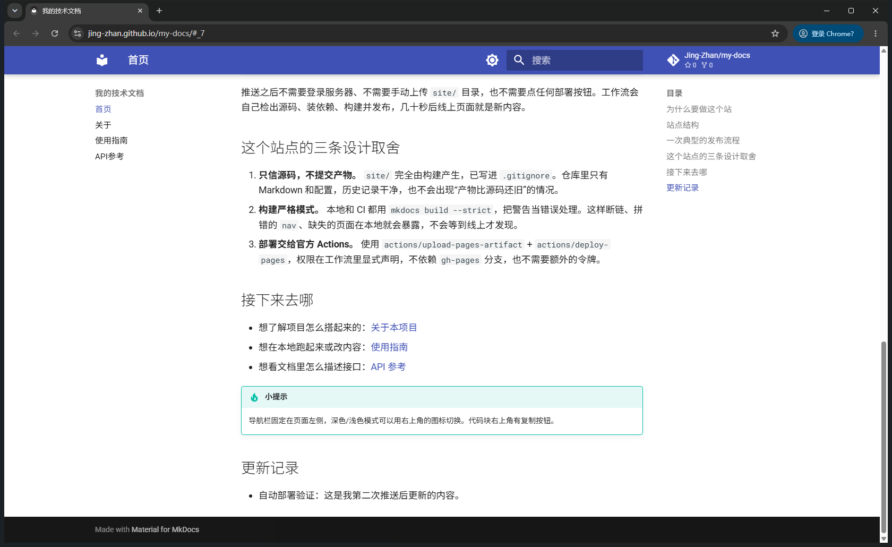

**说明**：这次验证的关键点是"没有点任何按钮"。第一次运行可以是手动触发，但这里是从 `git push` 到网页更新的完整链路，说明 `on.push` 触发器生效、`site/` 被重新构建并重新发布。

## 3. 问题与解决

### 3.1 Actions 运行摘要里的 Node.js 20 弃用警告

- **现象**：首次运行 `build`、`deploy` 均为绿色成功，但摘要区 `Annotations` 有 2 条 warning，内容为 `Node.js 20 is deprecated. The following actions target Node.js 20 but are being forced to run on Node.js 24: actions/configure-pages@v5, actions/upload-pages-artifact@..., actions/deploy-pages@v4`。
- **原因**：这些官方 Action 的 `action.yml` 里声明 `runs.using: node20`，而 GitHub 的托管 runner 已把 Node 24 作为默认运行时，属于"运行时升级提示"，不是我的配置错误。
- **处理**：核对三条证据后判定无需改动——① 运行结论为 `success`；② `deploy` 步骤输出中有 `page_url`，站点确实上线；③ 产物 `github-pages` 已生成（595 KB）。保留原版本号而不改成未经验证的新版本，避免为了消除提示而引入未知行为。
- **同理**：另有一条 notice 提示 `ubuntu-latest` 将于 2026-10 起迁移到 Ubuntu 26，属于平台侧计划通知。

### 3.2 Pages 没有配置 Source 时，部署会失败

- **现象**：部署步骤若在 Pages 未开启的情况下运行，`configure-pages` / `deploy-pages` 会报错（"Get Pages site failed" 一类）。
- **原因**：本方案不使用 `gh-pages` 分支，Pages 站点需要先存在，并明确把发布来源设为 GitHub Actions。
- **处理**：先完成 2.4 的 Pages 设置，再推送代码；确认 `Settings → Pages` 显示 "Your site is live at ..." 后才进行首次部署。

### 3.3 站点地址大小写与 `site_url` 不一致

- **现象**：GitHub 实际给出的站点地址是 `https://jing-zhan.github.io/my-docs/`（主机名为小写），而我最初在 `mkdocs.yml` 里按账号大小写写成 `https://Jing-Zhan.github.io/my-docs/`。
- **原因**：GitHub 账号名含大写字母，但 Pages 主机名统一为小写；`site_url` 会写进 `sitemap.xml` 和页面 canonical 链接。
- **处理**：把 `site_url` 改成小写形式，使其与 GitHub 显示的地址完全一致，`repo_url` 仍保留 `Jing-Zhan`（仓库路径区分大小写）。

### 3.4 PowerShell 默认执行策略会拦截虚拟环境激活脚本

- **现象**：执行 `.\.venv\Scripts\Activate.ps1` 时报"无法加载文件……未对文件进行数字签名"一类的执行策略错误。
- **原因**：Windows PowerShell 默认执行策略为 `Restricted`/`RemoteSigned`，从模板生成的 `Activate.ps1` 可能被判定为未签名来源。
- **处理**：只对当前进程放行，不修改系统策略：`Set-ExecutionPolicy -Scope Process -ExecutionPolicy Bypass`，然后激活成功，提示符出现 `(.venv)` 前缀，`python -m mkdocs` 也就指向了虚拟环境里的那份。作业文档中提到的"改用 Git Bash 激活"同理，关键是不要在系统级降低安全策略。

### 3.5 项目路径含中文时命令要用引号

- **现象**：在终端里切换目录或执行命令时，未加引号的 `D:\大三上作业\系统设计与分析\my-docs` 被当成多个参数。
- **原因**：路径含空格或中文时，`cd`/`Start-Process` 等需要显式引号界定参数边界。
- **处理**：统一写成 `cd 'D:\大三上作业\系统设计与分析\my-docs'`。这一点对 CI 没有影响（runner 上的工作目录是英文路径 `.../my-docs/my-docs`），但本地操作时要注意。

### 3.6 其他核对过的配置

- `.gitignore` 已包含 `site/`、`.venv/`、`__pycache__/`，`git status` 中没有出现构建产物与虚拟环境目录；
- 工作流 YAML 全部使用空格缩进，`nav` 中路径均为相对 `docs/` 的文件名；
- 只修改 `report/` 和 `README.md` 的提交没有触发新的运行，与 `paths` 过滤的预期一致；
- 仓库未开启全局读写权限，也未勾选 "Allow GitHub Actions to create and approve pull requests"。

## 4. 原理理解

**1. `docs/` 和 `site/` 各保存什么？为什么不用手工修改 `site/`？**

`docs/` 保存我手写的 Markdown 源文件，是唯一需要人工维护的内容；`site/` 保存 `mkdocs build` 生成的静态网站（每页对应的 `index.html`、`assets/` 下的 CSS/JS、`search/` 索引、`sitemap.xml`）。`site/` 完全由源文件和主题模板推导而来，每次构建都会先清空再生成，所以手改会被下次构建覆盖；它已加入 `.gitignore`，既不提交也不手工编辑。要改内容只改 `docs/`，要改样式/导航只改 `mkdocs.yml`。

**2. 本次工作流在什么情况下自动运行？**

推到 `main` 分支，且本次改动涉及 `docs/**`、`mkdocs.yml`、`requirements.txt` 或 `.github/workflows/deploy.yml` 中任一文件时自动运行。另外 `workflow_dispatch` 允许在 Actions 页面手动运行。改动 `report/`、`README.md` 等其他文件不会触发。落在其他分支上的提交也不会触发。

**3. `build` 与 `deploy` 两个任务有什么区别？**

`build` 是"造产物"：检出源码、安装 Python 与依赖、执行 `mkdocs build --strict` 生成 `site/`，再用 `upload-pages-artifact` 打包成 Pages 可用的产物，只需要 `contents: read`。`deploy` 是"发产物"：通过 `needs: build` 在构建成功后启动，拿到 `github-pages` 环境和 `pages: write`、`id-token: write` 权限，用 `deploy-pages` 把产物发布出去并回传 `page_url`。前者失败不影响线上（旧版本继续服务），后者才是真正改变线上内容的一步，职责和权限分离。

**4. 只修改 `report/README.md` 会触发部署吗？为什么？**

不会。工作流配置了 `on.push.paths`，只监听 `docs/**`、`mkdocs.yml`、`requirements.txt` 和工作流文件本身；`report/` 不在列表里，所以这次提交不会创建运行记录。这也是预期行为：报告变化不影响网站内容，没必要重建和重新发布。我在补充报告时正是这种情形。

**5. 本次方案为何无需创建 `gh-pages` 分支？**

因为发布方式不同。分支方案是让 MkDocs 用 `ghp-import` 把构建产物提交到 `gh-pages` 分支，再由 Pages 从该分支读取文件，需要写分支权限、需要处理分支与 `main` 的双份历史。本方案改为"产物即 artifact"：`upload-pages-artifact` 把 `site/` 打成 Actions 产物，`deploy-pages` 通过 OIDC（`id-token: write`）直接把该产物发布到 Pages，Pages 的发布来源设为 GitHub Actions。仓库里只保留源码一条历史，不需要额外的分支、令牌或 PR 审批。

## 5. 附：链接汇总

| 项目 | 地址 |
| --- | --- |
| 个人仓库 | <https://github.com/Jing-Zhan/my-docs> |
| 公开网站 | <https://jing-zhan.github.io/my-docs/> |
| 工作流定义 | <https://github.com/Jing-Zhan/my-docs/blob/main/.github/workflows/deploy.yml> |
| 站点配置 | <https://github.com/Jing-Zhan/my-docs/blob/main/mkdocs.yml> |
| 首次运行 | <https://github.com/Jing-Zhan/my-docs/actions/runs/42345026801> |
| 第二次运行（自动更新验证） | <https://github.com/Jing-Zhan/my-docs/actions/runs/42345176608> |
| 第二次提交 | <https://github.com/Jing-Zhan/my-docs/commit/cfb62414fc6707a9c0be92c4e05e4eca9026695b> |

返回 [仓库首页](../README.md) 或 [公开网站](https://jing-zhan.github.io/my-docs/)。
